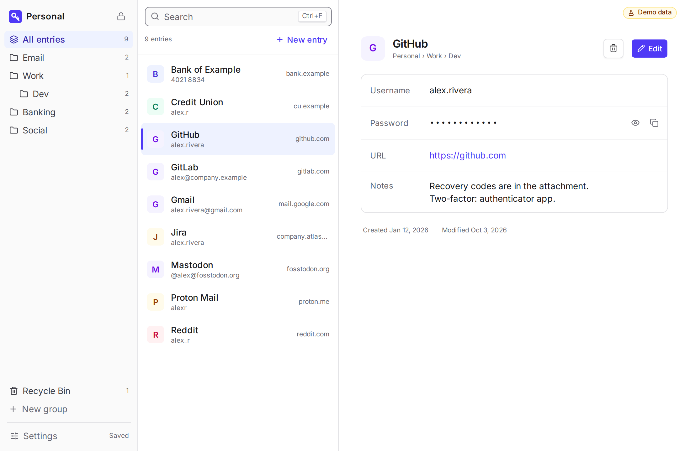
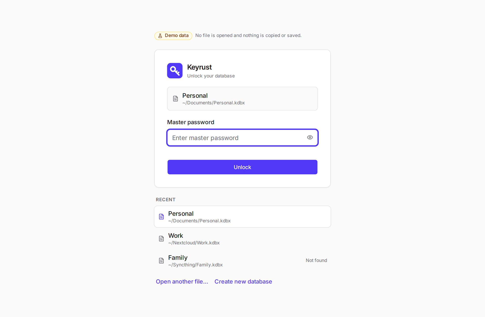
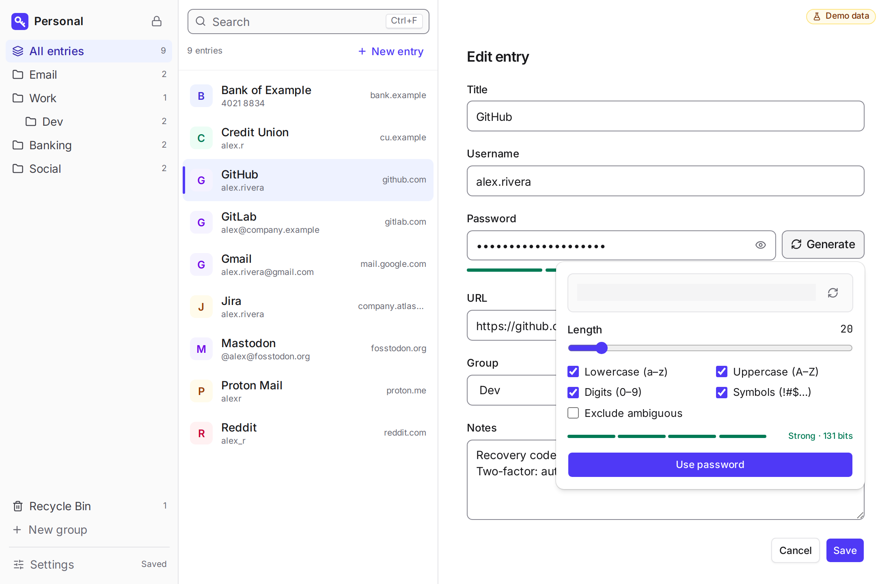
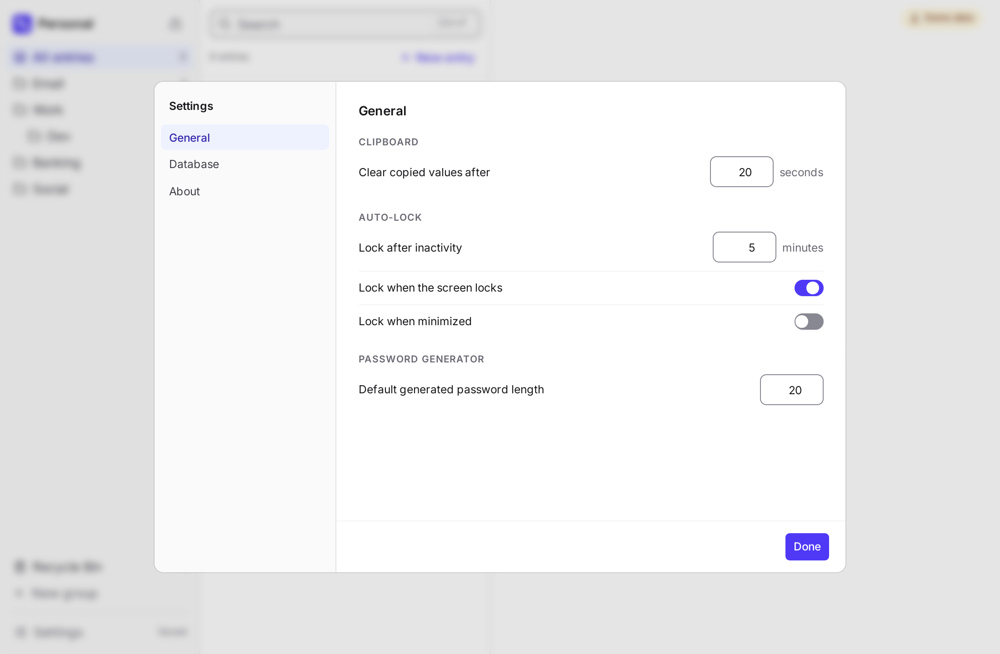
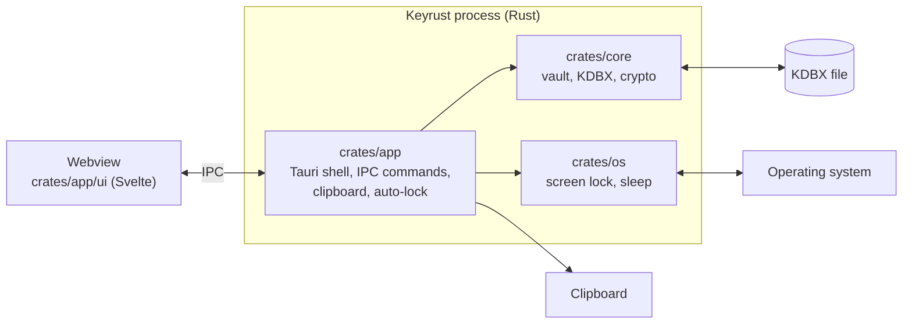

# Keyrust

[](https://github.com/downlevel/keyrust/actions/workflows/ci.yml)

**A calm, minimal KeePass client for the desktop, written in Rust.**

Keyrust is an open source password manager for Linux, Windows and macOS. It reads and writes the
standard **KDBX** format, so your database stays a plain file you own: open it with KeePassXC,
KeePassDX (Android) or Strongbox (iOS), and sync it with Syncthing, Nextcloud or Dropbox. No
account, no cloud, no telemetry, no network access.

> **Status: alpha, not audited.** Keyrust opens and saves real databases and is tested against
> KeePassXC in CI, but it is young software. Keep backups of your database.



<p>
  
  
  
</p>

The screenshots show the built-in demo data.

## Features

- Create, open and save KDBX databases protected by a master password. New databases use KDBX 4
  with Argon2id, calibrated to about one second on your computer.
- Groups (nested) and entries with title, username, password, URL and notes; entry history; a
  recycle bin with restore.
- Instant search over titles, usernames and URLs (never passwords).
- Password generator using the system's secure random source, with a strength estimate.
- Copy to the clipboard from the Rust process, cleared automatically after a delay, on lock and on
  exit.
- Auto-lock on inactivity, when the screen locks, when the computer sleeps, and optionally when
  the window is minimized.
- Safe saving: atomic writes, and detection of changes made by another app before saving
  (*Reload* or *Keep mine*). A write that lands in the instant between the last check and the
  save cannot be detected ([details](SECURITY.md#what-keyrust-does-not-protect-against)).
- Database settings: name, cipher, key-derivation parameters, recycle bin, master password.
- Everything works from the keyboard, with a command palette (Ctrl+K) and a shortcuts panel.
- Accessibility checked in CI: WCAG 2.1 AA contrast, visible focus, screen-reader roles and
  announcements, reduced motion ([details](docs/ACCESSIBILITY.md)).

### Not in this version

Auto-type, browser integration, keyfiles, hardware keys, TOTP codes, import from other password
managers, attachments in the UI (existing attachments are preserved), a dark theme, and merging
sync conflicts. Some are planned ([roadmap](docs/TASKS.md)); auto-type, a browser extension and a
sync server of our own are not ([product requirements](docs/PRD.md)).

## Security in one minute

- The file is encrypted and authenticated (KDBX4). Its safety rests on your master password.
- Key-derivation parameters are checked before the key is derived, so a file tampered with by a
  sync provider cannot freeze your computer.
- Passwords are not in the entry list, the details or search results, and copying happens in Rust.
  The webview sees a password only while you edit, reveal or generate it.
- The vault locks itself, from the Rust process, even if the UI hangs.
- Memory-safe Rust, `unsafe` confined to a few operating-system calls, no hand-written
  cryptography, audited dependencies, fuzzing of the file parser.
- Not protected: malware on an unlocked computer, a weak master password, a sync provider deleting
  or rolling back your file.

The full threat model is in [SECURITY.md](SECURITY.md).

## Architecture



`crates/core` is the vault and the file format, with no UI dependency, built on keepass-rs and
RustCrypto. `crates/app` is the Tauri 2 desktop shell: the only way the UI reaches the vault is a
fixed list of IPC commands. `crates/os` detects screen lock and sleep, and is the only crate with
`unsafe` code. Details are in [docs/ARCHITECTURE.md](docs/ARCHITECTURE.md).

## Compatibility

- **KeePassXC:** tested automatically both ways in CI on Linux, Windows and macOS. Keyrust opens
  files made by KeePassXC and saves them without losing custom fields, attachments, history or
  anything it does not display, and KeePassXC reads every file Keyrust writes.
- **KeePassDX and Strongbox:** use the same format, but have not been verified by hand yet.
- **KDBX 3.1 and 4.0:** open normally; the first save converts the file to KDBX 4.1, and Keyrust
  tells you so when you open it. Very old clients that only read KDBX 3.1 cannot open the
  converted file.

## Keyrust and KeePassXC

[KeePassXC](https://keepassxc.org) is mature and full-featured, and Keyrust uses it as the
reference for compatibility. The comparison below is as of KeePassXC 2.7.

| | KeePassXC 2.7 | Keyrust 0.1 |
|---|---|---|
| KDBX 4 format | ✅ | ✅ |
| Auto-type | ✅ | ❌ |
| Browser integration | ✅ | ❌ |
| Keyfiles, YubiKey | ✅ | ❌ |
| TOTP codes | ✅ | ❌ |
| Import (CSV, 1Password, Bitwarden…) | ✅ | ❌ |
| KeeShare, SSH agent | ✅ | ❌ |
| Interface | Feature-rich | Minimal, three columns, keyboard-first |
| Language | C++ | Rust (memory-safe) |
| Where passwords are held | One C++ / Qt process | The Rust process; the UI webview only while you edit, reveal or generate one |
| Compatibility with KeePassXC | — | Verified in CI against `keepassxc-cli` |

If you need any of the features Keyrust lacks, KeePassXC is the right choice, and your database
works in both.

## Building

Prerequisites for each OS are in [docs/DEVELOPMENT.md](docs/DEVELOPMENT.md). In short:

```sh
cd crates/app/ui
pnpm install
pnpm tauri dev            # run the desktop app
pnpm tauri build          # build an installer for this OS
```

`pnpm dev` alone runs the UI in a browser on demo data (password `secret`).

## Testing

```sh
cargo test -p keyrust-core          # core; KeePassXC compatibility needs keepassxc-cli
cd crates/app/ui
pnpm test                           # UI unit and component tests (Vitest)
pnpm test:web                       # accessibility audit in Chromium (Playwright + axe)
```

The end-to-end test of the real app (`crates/app/e2e`, WebdriverIO and tauri-driver) runs in CI
on Linux. See [docs/DEVELOPMENT.md](docs/DEVELOPMENT.md).

## Documentation

- [Product requirements](docs/PRD.md) · [Architecture](docs/ARCHITECTURE.md) · [Design](docs/DESIGN.md)
  · [Accessibility](docs/ACCESSIBILITY.md)
- [Roadmap](docs/TASKS.md) · [Development guide](docs/DEVELOPMENT.md) · [Contributing](CONTRIBUTING.md)
- [Security policy and threat model](SECURITY.md)

## License

Copyright © 2026 Mauro Giulivi. Licensed under the [GNU General Public License v3.0 or later](LICENSE).
