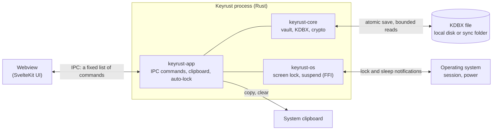

# Security policy

Keyrust is **alpha software and has not been audited by a third party**. It is designed to be
safe to use, and this document says exactly what that means. Keep backups of your database.

## Reporting a vulnerability

Please **do not open a public issue**. Report vulnerabilities privately through GitHub's
[private vulnerability reporting](https://docs.github.com/en/code-security/security-advisories/guidance-on-reporting-and-writing-information-about-vulnerabilities/privately-reporting-a-security-vulnerability)
("Report a vulnerability" in the repository's *Security* tab).

Please include the affected version or commit, steps to reproduce and the impact you expect.
You can expect an acknowledgement within 7 days. Fixes are released as soon as practical, and
reporters are credited unless they prefer otherwise.

## Supported versions

| Version | Supported |
|---|---|
| `0.1.x` | ✅ once released |
| `main` | ✅ best effort, until `0.1.0` is released |
| anything else | ❌ |

## Scope

This threat model covers Keyrust 0.1: the desktop app for Linux, Windows and macOS, opening and
saving KDBX files protected by a master password. Keyfiles, hardware keys, TOTP, browser
integration and auto-type do not exist in this version. Every statement below refers to code or
tests in this repository. When the code and this document disagree, that is a bug.

## Assets

| Asset | Where it lives |
|---|---|
| The database contents (passwords, usernames, URLs, notes, attachments, history) | The KDBX file, encrypted. In clear only in the memory of the Rust process while unlocked |
| The master password | Typed by the user in the webview; the Rust process keeps it in a `SecretString` while unlocked |
| The derived key | Rust process memory, while unlocked |
| Values copied to the clipboard | The system clipboard, until cleared |
| `settings.json` in the app config folder | Not secret, but it reveals the paths of recent databases |

## Trust boundaries

- **Rust ↔ webview.** The webview is treated as less trusted than the Rust process. It talks to
  the backend only through the IPC commands listed [below](#ipc-surface), with the default Tauri
  core permissions and no file system, shell or opener plugin access.
- **Rust ↔ file system and sync provider.** The file may be read and modified by other programs
  at any time: a sync client, another KeePass app, or an attacker who controls the sync account.
- **Rust ↔ clipboard.** Anything on the clipboard is readable by every program of the same user.
- **Rust ↔ operating system.** Screen-lock and sleep notifications come from the OS. Only
  `crates/os` makes foreign function calls to obtain them.

## Attackers considered

| Attacker | Capability | Mitigation | Where | Residual risk |
|---|---|---|---|---|
| Thief of the file (lost laptop, leaked backup, cloud breach) | Reads the file offline | KDBX4 encryption; Argon2id for new databases (64 MiB, 2 lanes, iterations calibrated to about 1 s) | `crates/core/src/vault.rs` (`create`, `argon2id`) | A weak master password can still be guessed |
| Hostile sync provider | Reads, alters, deletes or rolls back the file | HMAC-authenticated header and content; key-derivation limits checked before deriving the key; bounded reads; external changes detected before every save | `crates/core/src/kdbx/limits.rs`, `crates/core/src/file.rs`, fuzz targets in `fuzz/` | Deletion and rollback to an older valid file cannot be detected: keep backups |
| Compromised webview content (a hypothetical XSS) | Runs script in the UI | Strict CSP (no inline or remote script, no network except IPC), minimal capabilities; file paths come only from native dialogs or the recent files; lists and entry details never carry passwords | `crates/app/tauri.conf.json`, `crates/app/capabilities/`, `crates/app/src/commands.rs`, `crates/app/tests/security_config.rs` | It can read what is open in the editor, revealed or generated, and call the allowed commands, including `copy_field` and `reveal_field` (see [The webview boundary](#the-webview-boundary)) |
| Someone at the computer | Uses an unlocked or locked session | Auto-lock on inactivity, screen lock, sleep and optionally minimize; masked passwords; clipboard cleared | `crates/app/src/autolock/`, `crates/os/` | An unlocked, unattended session before the idle delay expires |
| Other programs of the same user | Read the clipboard, memory, the screen, input | Clipboard cleared after a delay, on lock and on exit, and excluded from clipboard history where the platform supports it | `crates/app/src/clipboard.rs` | Not defended: see [What Keyrust does not protect against](#what-keyrust-does-not-protect-against) |
| Supply chain | Malicious or vulnerable dependency | Pinned lockfiles, `cargo deny` (advisories, licenses, sources), no hand-written cryptography, pinned CI actions | `deny.toml`, `.github/workflows/ci.yml` | A compromised upstream release that passes these checks |

## Mitigations

- **Encryption at rest.** The file is encrypted per the KDBX4 specification. New databases use
  Argon2id with explicit parameters, never library defaults; the parameters can be changed in
  *Database settings*. KDBX 3.1 and 4.0 files open normally; the first save converts them to
  KDBX 4.1, and Keyrust says so with a notice when such a file is opened.
- **Tampering.** KDBX4 authenticates the header and the payload with HMAC. A modified file is
  rejected rather than silently opened.
- **Hostile files.** The key-derivation parameters are read before anything is authenticated,
  so a tampered file could ask for any amount of memory or time. Keyrust checks them before
  deriving the key and refuses files beyond Argon2 2 GiB of memory, 1000 iterations or 256 lanes,
  2·10⁹ AES-KDF rounds, or a file size of 512 MiB ("This database asks for more memory or time
  than Keyrust allows"). The same limits bound what Keyrust itself lets you create, and a save
  that would write a file beyond the size limit is refused, leaving the file on disk as it was.
  Reads are bounded too, including the checks for external changes. The parsing path is fuzzed:
  headers, whole files, and save/open round trips ([fuzz/README.md](fuzz/README.md)).
- **Data loss on save.** Saves are atomic: a temporary file in the same folder, fsync, then
  rename. Before replacing the file, Keyrust checks twice that it still holds exactly the bytes
  it last read or wrote (length and SHA-256). If another program changed it, the save is refused
  and you choose between *Reload* and *Keep mine*. Keyrust instances on the same computer also
  coordinate through a lock file. The reported KDBX version changes only once the file has been
  replaced.
- **Resurrected deletions.** Permanently deleted entries and groups are recorded as KDBX
  tombstones, so merging in another KeePass client does not bring them back.
- **Secrets in the Rust process.** Secret values are held in `zeroize` / `secrecy` types and
  wiped when dropped. They are never logged (a test checks the log output), never written to
  disk in clear text, and redacted in `Debug` output.
- **Clipboard.** Copying happens in Rust (`copy_field`): the password does not pass through the
  webview. Keyrust keeps only a hash of what it copied, and clears the clipboard after the
  configured time, on lock and on exit, only if the clipboard still holds that value. It asks the
  platform to exclude copied secrets from clipboard history where supported.
- **Auto-lock, decided in the Rust process.** The vault is dropped and zeroized there, even if
  the webview hangs:
  - after the configured minutes of inactivity (keyboard, pointer and wheel input in the window);
  - when the screen locks (option, on by default): Windows and macOS poll the session state
    every 2 s, Linux listens to the desktop's `ScreenSaver.ActiveChanged` signal on D-Bus;
  - when the computer goes to sleep, always: Windows power notification, Linux logind
    `PrepareForSleep`, and everywhere a detector of wall-clock jumps (the only one on macOS);
  - when the window is minimized (option, off by default).

  An unlock still deriving the key when a lock arrives is discarded, so it cannot undo the lock.
  Like the manual Lock, an automatic lock asks nothing: changes that could not be saved are lost,
  and the Unlock screen says so.
- **Memory safety.** Rust with `unsafe_code` forbidden in `keyrust-core` and `keyrust-app`. The
  only `unsafe` code is in `crates/os/src/lib.rs`, a few FFI calls: whether the screen is locked
  (Windows `OpenInputDesktop`, macOS `CGSessionCopyCurrentDictionary`) and the Windows suspend
  notification (`PowerRegisterSuspendResumeNotification`). There it is denied crate-wide and
  allowed function by function, each block with a `SAFETY:` comment (enforced by clippy).
- **Compatibility as a safety property.** Files written by Keyrust are read back by KeePassXC
  (`keepassxc-cli`) in CI, and KeePassXC files are opened and saved by Keyrust without loss
  (`crates/core/tests/`). An end-to-end test drives the real app and checks the saved file with
  KeePassXC (`crates/app/e2e/`).

### The webview boundary

The UI runs in a webview, whose JavaScript strings cannot be reliably erased. Keyrust therefore
keeps passwords out of it except when the user is working with one:

- **Never sent to the webview:** the group tree, the entry list (`EntrySummary`: title, username,
  URL), the entry details (`EntryDetail`: notes, dates, whether a password exists), search results
  and custom protected fields. Copying a password to the clipboard happens in Rust. The end-to-end
  test checks that no fixture password appears anywhere in the page (text, attributes, field
  values) after unlocking and after selecting an entry.
- **Sent to the webview, on request:** the password of the entry being edited
  (`get_entry_for_edit`), a password the user reveals (`reveal_field`), and a generated password
  (`generate_password`).
- **Typed in the webview:** the master password (Unlock, Create, Change master password) and the
  entry fields the user types. The Unlock field is cleared after every attempt.

From there the limit above applies: those strings may remain in the webview's memory until it
reuses it. A compromised webview could read whatever is open in the editor, revealed or generated,
and could call the allowed IPC commands. It could not choose which files to open or create: paths
come only from native dialogs and the recent files.

## What Keyrust does not protect against

- **A compromised computer while the vault is unlocked.** Malware running as your user
  (keyloggers, screen capture, memory readers, clipboard monitors) can read what you can read. No
  password manager can defend against this.
- **A weak or reused master password.** The key derivation slows guessing down; it cannot make a
  weak password strong.
- **Physical access to an unlocked session.**
- **Memory forensics after the fact.** Wiping is best effort. The operating system may swap memory
  to disk or produce crash dumps, and the webview's JavaScript engine does not guarantee that
  strings are erased (see [The webview boundary](#the-webview-boundary)).
- **Clipboard managers and history.** Keyrust cannot control third-party clipboard tools.
- **Sync conflicts and malicious sync providers.** A provider cannot read the file, but it can
  delete it or roll it back to an older version. Keep backups. A program that does not use
  Keyrust's lock (another KeePass client, a sync tool) can still write in the instant between
  Keyrust's last check and its rename; that window cannot be closed without operating-system
  support. Keyrust does not merge concurrent changes: it detects them and asks.
- **Auto-lock gaps.** Screen-lock detection on Linux depends on the desktop sending the D-Bus
  signal (GNOME, KDE, MATE and Cinnamon do; some minimal window managers do not). On macOS sleep is
  detected from a jump of the clock, so a sleep and wake cycle shorter than 4 seconds, with
  "require password after sleep" turned off, is not noticed. Setting the clock forward by more than
  4 seconds locks needlessly (the safe side). The idle timer only counts input inside Keyrust's
  window.
- **Decompression bombs inside an authenticated file.** keepass-rs decompresses the content only
  after verifying its HMAC with your key, so such a file can only be made by someone who has your
  master password, and with it they already have everything. A decompression cap is to be
  requested upstream.
- **Very old KeePass clients.** After the first save a database is KDBX 4.1; clients that only
  read KDBX 3.1 cannot open it any more.
- **Side channels, and a compromised build or update channel.**

## IPC surface

The webview can call exactly these commands, defined in
[`crates/app/src/commands.rs`](crates/app/src/commands.rs). A test
([`crates/app/tests/security_config.rs`](crates/app/tests/security_config.rs)) fails if one is added
or removed without updating it, and also checks the capabilities, the plugin permissions and the
production CSP.

| Commands | What they expose or do |
|---|---|
| `app_info`, `get_settings`, `update_settings`, `exit_app` | Version, preferences (no secrets); the recent files belong to the backend and cannot be set from the webview |
| `recent_files`, `choose_database_file`, `choose_new_database_path` | File names and paths; new paths only from native dialogs |
| `unlock`, `create`, `lock_vault`, `activity` | Open or create a database at an allowed path, lock it, report activity for the idle timer |
| `database_info`, `tree`, `list_entries`, `get_entry` | Names, cipher, KDF parameters, version; groups; summaries and details without passwords |
| `get_entry_for_edit`, `reveal_field` | The editable entry, password included; one field on request |
| `copy_field` | Copies a field to the clipboard from Rust and returns the clear delay |
| `save_entry`, `delete_entry`, `restore_entry`, `create_group`, `rename_group`, `delete_group` | Changes to entries and groups |
| `update_database`, `change_master_password` | Database name, cipher, KDF and recycle bin; master password |
| `save`, `save_overwrite`, `reload`, `check_file` | Write the file (refused if it changed on disk, unless *Keep mine*), re-read it, detect an external change |
| `generate_password`, `estimate_strength`, `benchmark_kdf` | Generated passwords (system CSPRNG), strength estimates, KDF calibration |
| `open_url` | Opens an entry's URL in the system browser, `http` and `https` only |

## Development rules

- No hand-written cryptographic primitives: only standard, maintained libraries (RustCrypto,
  keepass-rs).
- Argon2id for new databases, with explicit parameters (never library defaults).
- Secrets: `zeroize` / `secrecy`, never logged, never serialised in clear text, never in `Debug`
  output.
- Minimal Tauri capabilities and a strict Content Security Policy; no remote resources and no
  network access in v1.
- A new IPC command is a security change: it is added to the test above and to the table in this
  document.

## Verifying releases

Starting with v0.1.0, release artifacts will be published with SHA-256 checksums and signatures,
and this section will explain how to verify them. Until then, build from source
([docs/DEVELOPMENT.md](docs/DEVELOPMENT.md)).
